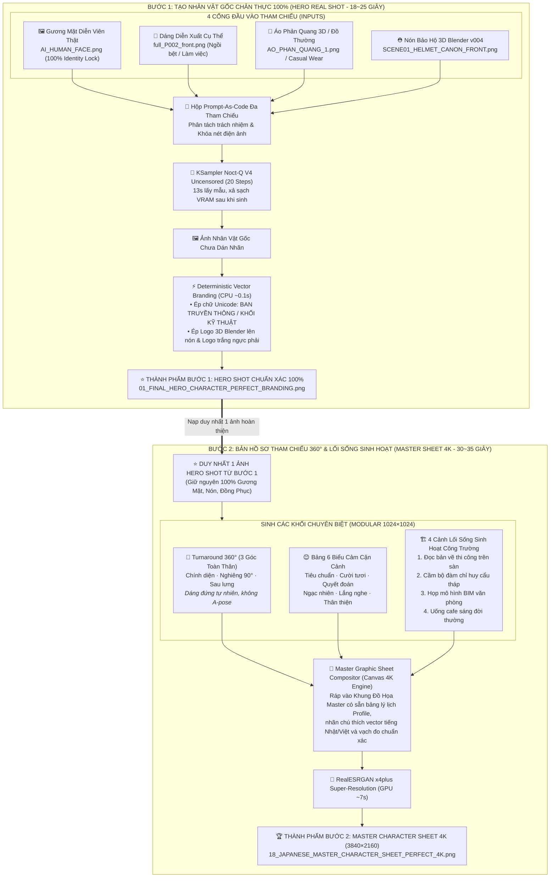
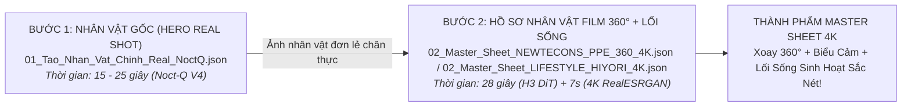

# ComfyUIStudio

Bộ code **engine phim + workflow ComfyUI + cài đặt model** cho hai dòng phim dùng chung một hạ tầng:

| Domain (không bao giờ trộn) | Là gì | Skill gốc |
|---|---|---|
| `newtecons_live_action` | NEWTECONS - phim người thật (CHAR_01-08, đồng phục, công trường/văn phòng) | [create-video-newtecons-comfyui](skills/create-video-newtecons-comfyui/SKILL.md), [create-video-newtecons](skills/create-video-newtecons/SKILL.md), [nhan-vat-ai-newtecons](skills/nhan-vat-ai-newtecons/SKILL.md) |
| `jenniejoy_cartoon_3d` | JennieJoyKids - hoạt hình 3D | [create-video-jenniejoykids](skills/create-video-jenniejoykids/SKILL.md) |

Hai domain chỉ chia sẻ **engine** ([studio-video-engine](skills/studio-video-engine/SKILL.md)); cast, prompt, workflow, recipe, anchor và tiêu chí nghiệm thu **không dùng chung**. Luật nằm trong `skills/studio-video-engine/domains/*.json`.

> Repo này **không chứa** file model (`*.safetensors`, `*.ckpt`, `*.pth`, `*.gguf`, `*.bin`), không chứa video/audio render, không chứa khoá/token. Model tải bằng [models/DOWNLOAD-MODELS.ps1](models/DOWNLOAD-MODELS.ps1) theo [models/model-manifest.csv](models/model-manifest.csv).

## 1. Cấu trúc repo

| Thư mục | Nội dung |
|---|---|
| [skills/](skills/) | 16 skill: `studio-video-engine` (CLI `jjv`), `jenniejoy-remotion`, `jenniejoy-studio-webapp`, `jenniejoy-hyperframes`, `jenniejoy-music-sfx-yue`, `nhan-vat-ai-newtecons`, `tao-anh-prompt-as-code`, `pose-costume-character`, `create-video-newtecons(-comfyui)`, `create-video-jenniejoykids` (không kèm thư mục `assets/` 273 MB), `comfyui-video-pipeline`, `comfyui-blender`, `opus-motion-engineering`, `cognee-hindsight-mesh`, `hindsight-ky-uc-phan-tang` |
| [comfyui/custom_nodes/](comfyui/custom_nodes/) | `newtecons_*` (branding, live_preview, project_panel, step_ui), `codex_lane_bridge`, `comfyui-krea2edit`, `H3-Character-Sheet-Designer`, `rgthree-comfy` |
| [comfyui/workflows/user/](comfyui/workflows/user/) | workflow người dùng đã lưu của cả hai phim (cây "ProjectStudio5 - Film Newtecons", JENNIEJOYKIDS, NEWTECONS_H3, ...) |
| [comfyui/workflows/key-graphs/](comfyui/workflows/key-graphs/) | graph `*.api.json` mẫu: H3, Image Gen, SeedVR2 |
| [comfyui/patches/](comfyui/patches/) | bản vá cho lõi ComfyUI (`comfy/ldm/minimax/vae.py`) |
| [docker/comfyui/](docker/comfyui/) | `compose.yaml`, `Dockerfile`, `idle_release.py`, `requirements-runtime.txt` |
| [docker/voicestudio/](docker/voicestudio/) | VoiceStudio/OmniVoice (một server giọng dùng chung) |
| [models/](models/) | `model-manifest.csv` + `DOWNLOAD-MODELS.ps1` |
| [tools/](tools/) | overlay/logo (`h3-tracked-overlay`, `logo-composite`) và dựng cut (`cut-builder`) |
| [docs/](docs/) | E2E, bàn giao, danh mục model |

## 2. Điều kiện trước khi cài (máy công ty)

- GPU NVIDIA + driver mới (máy gốc: RTX 5080 16 GB, PyTorch `cu130` trong [Dockerfile](docker/comfyui/Dockerfile) nên cần driver hỗ trợ CUDA 13). Kiểm: `nvidia-smi`.
- Windows 11, WSL2, **Docker Engine chạy trong WSL** (hoặc Docker Desktop - tuỳ công ty; compose dùng `gpus: all` nên cần NVIDIA Container Toolkit / hỗ trợ GPU của Docker).
- Git, Python 3.12 (chạy `jjv` bằng `python -I`), FFmpeg/ffprobe trong PATH, PowerShell 5.1+.
- Ổ đĩa: model đầy đủ ~**204 GB** (tổng trong manifest; `docs/MODEL-CATALOG.md`). Để model trên SSD NVMe - máy gốc đo đọc từ ổ HDD chỉ 6,9 MB/s so với 347 MB/s trên NVMe.
- **Giấy phép**: kiểm điều khoản từng model trước khi dùng thương mại (MiniMax-H3, Krea-2, FLUX.2/FLUX.1-dev, Qwen-Image, Wan 2.2, SeedVR2, YuE, ACE-Step, Stable Audio, LivePortrait/InsightFace...). Manifest ghi nguồn (repo + revision + URL); **giấy phép từng model chưa được rà trong repo này** - nhờ bộ phận pháp chế xác nhận. Một số repo Hugging Face cần `huggingface-cli login` (token không đưa vào repo).

### 2.1 `.wslconfig` (mẫu, đặt ở `%UserProfile%\.wslconfig`)

```ini
[wsl2]
memory=48GB
swap=0
processors=16
```

Sau đó chạy `wsl --shutdown` rồi mở lại. `memory=48GB` là mẫu cho máy ≥64 GB RAM; compose giới hạn ComfyUI `mem_limit: 28g`, VoiceStudio `mem_limit: 10g`. Giảm cho khớp RAM thật của máy công ty.

### 2.2 Pagefile và power plan (PowerShell quản trị, mẫu)

```powershell
# Pagefile cố định 64 GB trên ổ NVMe (đổi C: nếu cần) - cần reboot
$cs = Get-CimInstance Win32_ComputerSystem
if ($cs.AutomaticManagedPagefile) { Set-CimInstance -InputObject $cs -Property @{AutomaticManagedPagefile=$false} }
$pf = Get-CimInstance Win32_PageFileSetting -ErrorAction SilentlyContinue
if ($pf) { $pf | Remove-CimInstance }
New-CimInstance -ClassName Win32_PageFileSetting -Property @{Name='C:\pagefile.sys'; InitialSize=65536; MaximumSize=65536} | Out-Null

# Power plan High performance (render dài không bị hạ xung)
powercfg /setactive SCHEME_MIN
powercfg /change standby-timeout-ac 0
powercfg /change monitor-timeout-ac 0
```

## 3. Thứ tự cài

Quy ước: `ROOT` = thư mục chạy thật (vd `C:\Studio`). Compose gốc dùng đường dẫn tương đối `../ComfyUI`, nên dựng cấu trúc `production-local/` như máy gốc.

```powershell
# 1) clone
git clone https://github.com/Long0308/ComfyUIStudio.git C:\src\ComfyUIStudio
$R = "C:\Studio\production-local"
New-Item -ItemType Directory -Force $R\comfyui-docker, $R\voicestudio-docker, $R\ComfyUI\user\default | Out-Null

# 2) lõi ComfyUI đúng bản máy gốc (v0.41.0, commit e087d8f6) + bản vá minimax vae
git clone https://github.com/comfy-org/ComfyUI.git $R\ComfyUI_core
git -C $R\ComfyUI_core checkout e087d8f6
# (đưa nội dung $R\ComfyUI_core lên $R\ComfyUI, giữ thư mục .git nếu muốn)
git -C $R\ComfyUI apply C:\src\ComfyUIStudio\comfyui\patches\comfyui-core-minimax-vae.patch

# 3) chép docker + custom nodes + workflows
Copy-Item C:\src\ComfyUIStudio\docker\comfyui\*     $R\comfyui-docker -Recurse -Force
Copy-Item C:\src\ComfyUIStudio\docker\voicestudio\* $R\voicestudio-docker -Recurse -Force
Copy-Item C:\src\ComfyUIStudio\comfyui\custom_nodes\* $R\ComfyUI\custom_nodes -Recurse -Force
Copy-Item C:\src\ComfyUIStudio\comfyui\workflows\user\* $R\ComfyUI\user\default\workflows -Recurse -Force

# 4) tải model (xem 3.1), rồi sửa dòng mount model trong compose.yaml cho đúng -BaseDir
#    "<BaseDir>/ComfyUI:/opt/ComfyUI/models:ro"
C:\src\ComfyUIStudio\models\DOWNLOAD-MODELS.ps1 -BaseDir D:\AI-Models\2.Model-AI-Local -WhatIf   # xem trước
C:\src\ComfyUIStudio\models\DOWNLOAD-MODELS.ps1 -BaseDir D:\AI-Models\2.Model-AI-Local

# 5) dựng và chạy ComfyUI
cd $R\comfyui-docker ; docker compose up -d --build
# 6) VoiceStudio - MỘT server giọng dùng chung (mục 6)
cd $R\voicestudio-docker ; docker compose up -d
```

Việc cần sửa tay trên máy mới (đường dẫn máy gốc còn trong file):
- `docker/comfyui/compose.yaml`: dòng mount model `C:/AI-Models-Fast/2.Model-AI-Local/ComfyUI:/opt/ComfyUI/models:ro` -> đổi sang `<BaseDir>/ComfyUI`; volume `../engine/bridge` chỉ cần nếu dùng `codex_lane_bridge`.
- `docker/voicestudio/docker-compose.yml`: các biến `VS_SRC`, `VS_DOCKERFILE`, `VS_DATA`, `VS_HF_CACHE`, `VS_HACHT` mặc định trỏ đường dẫn máy gốc - đặt biến môi trường hoặc sửa. **Mã nguồn VoiceStudio runtime (`VS_SRC`) không nằm trong repo này.**

### 3.1 Tải model

`DOWNLOAD-MODELS.ps1` đọc `model-manifest.csv`, tải vào `<BaseDir>\<relative_path>`, kiểm size + sha256, hỗ trợ tiếp tục tải (curl `-C -`). Lọc: `-Only "minimax_h3","seedvr2"`. Dòng VoiceStudio/HuggingFace chỉ in lệnh `huggingface-cli download`. Dòng không có URL được cảnh báo (nguồn chưa xác minh).

### 3.2 Whitelist custom node

ComfyUI chạy với `--disable-all-custom-nodes --whitelist-custom-nodes ...` và `--disable-partner-nodes` (cấm node API trả tiền như `ClaudeNode`). Chỉ các node sau được nạp (trong `command:` của compose):

`comfyui-krea2edit`, `newtecons_live_preview`, `newtecons_branding`, `newtecons_step_ui`, `codex_lane_bridge`, `newtecons_project_panel`.

Thêm node mới = thêm tên vào danh sách whitelist **và** ghi rõ lý do; không bật cloud partner node trong graph render.

### 3.3 Mở workflow

Mở `http://127.0.0.1:8188/`, panel Workflows: cây `ProjectStudio5 - Film Newtecons` (`00 UAT`, `01 Workflow Image`, `02 Workflow Video`, `03 Workflow Audio`), thư mục `H3_Character_Sheet` và các thư mục `JENNIEJOYKIDS*`. Graph API mẫu để chạy bằng script: [comfyui/workflows/key-graphs/](comfyui/workflows/key-graphs/).

### 3.4 Cập nhật và đồng bộ ở máy nhà (Pull & Setup model mới)

Khi về máy nhà, để đồng bộ các cập nhật mới nhất từ công ty:

1. **Kéo code mới**:
   ```powershell
   cd C:\ComfyUIStudio
   git pull origin main
   ```
2. **Chép bổ sung custom nodes và workflows vào ComfyUI**:
   ```powershell
   robocopy "C:\ComfyUIStudio\comfyui\custom_nodes" "<Thư mục ComfyUI>\custom_nodes" /E
   robocopy "C:\ComfyUIStudio\comfyui\workflows\user" "<Thư mục ComfyUI>\user\default\workflows" /E
   ```
3. **Tải các model mới bổ sung (Noct-Q Uncensored, Qwen 2.1, SDPose, Z-Image ControlNet)**:
   ```powershell
   # Tải các model mới thêm vào:
   powershell -ExecutionPolicy Bypass -File C:\ComfyUIStudio\models\DOWNLOAD-MODELS.ps1 -BaseDir "<Thư mục Models>" -Only "NoctQ","qwen3vl_8b","qwen_image_2.1_vae","sdpose","Z-Image-Turbo-Fun"
   ```
4. **Tạo Hardlink cho H3 Character Sheet (nếu workflow dùng tên cũ DasiwaMinimaxH3)**:
   ```cmd
   rem Chạy trong Command Prompt hoặc PowerShell admin:
   cd /d "<Thư mục Models>\ComfyUI\diffusion_models"
   if not exist minimax mkdir minimax
   mklink /H "minimax\DasiwaMinimaxH3_dasiwaHybridV2_int8.safetensors" "minimax_h3_ref2va_pruned_int8_convrot.safetensors"
   mklink /H "minimax\DasiwaMinimaxH3_dasiwaHybridV4_int8.safetensors" "minimax_h3_ref2va_pruned_int8_convrot.safetensors"
   ```
5. Khởi động lại ComfyUI và tải lại trang web `http://127.0.0.1:8188` (Ctrl + F5).

### 3.5 Sơ đồ Kiến Trúc Tổng Thể: Quy Trình 2 Bước Chuẩn Phim Điện Ảnh AI



#### 💡 Bảng Phân Biệt Bản Chất Giữa Dáng Bước 1 và Dáng Bước 2:
| Tiêu chí | Dáng ở BƯỚC 1 (Hero Shot) | Dáng ở BƯỚC 2 (Master Character Sheet) |
|---|---|---|
| **Bản chất** | **Dáng diễn xuất một cảnh cụ thể** (Narrative Action Pose) | **Hệ thống dáng tham chiếu 360° & Bộ cử chỉ sinh hoạt** (Turnaround & Lifestyle Suite) |
| **Số lượng** | **Duy nhất 1 dáng** (ngồi bệt `P002`, đứng tựa lan can...) | **Tổ hợp nhiều dáng** (3 góc đứng 360° + 4 cảnh hành động công trường) |
| **Nếp nhăn vải** | Vải áo quần gập sâu, kéo căng tự nhiên theo trọng tâm cơ thể | Vải buông tự nhiên theo phương thẳng đứng, lộ rõ chỉ may và phụ kiện |
| **Mục đích** | **Xuất shot phim cụ thể** đưa ngay vào timeline dựng | **Hồ sơ gốc cho đoàn phim & AI**: nạp vào AI Video (Wan 2.1, MiniMax, SeedVR2) để nhân vật không bao giờ bị biến dạng |

#### ⚠️ Lưu ý kỹ thuật cho Developer & Custom Node Builder:
* Trong LiteGraph / ComfyUI JSON, mọi cổng ra tại `node.outputs` **bắt buộc phải có `"slot_index": 0, 1...`**. Nếu thiếu thuộc tính này, LiteGraph sẽ không xác định được chân cắm đầu ra và **ẩn toàn bộ dây nối trên canvas**.
* Cấu trúc liên kết `links` chuẩn: `[link_id, origin_node_id, origin_slot_index, target_node_id, target_slot_index, "TYPE"]`.
* Top-level JSON bắt buộc phải có `"version": 0.4`.

### 3.6 Hệ thống Ký Ức Phân Tầng (Hindsight & Cognee Mesh)

Repo đã tích hợp sẵn 2 skill quản trị ký ức dài hạn để đồng bộ tri thức khi làm việc ở máy công ty và máy nhà:
* [skills/hindsight-ky-uc-phan-tang](skills/hindsight-ky-uc-phan-tang/SKILL.md): Quản trị ký ức phân tầng, bảo mật hai kho không trộn (Local `:8890` vs VPS `:8888`), lưu trữ kinh nghiệm sửa lỗi, thông số render và bẫy kỹ thuật.
* [skills/cognee-hindsight-mesh](skills/cognee-hindsight-mesh/SKILL.md): Semantic Knowledge Graph kết hợp Vector Memory để tra cứu chéo ngữ cảnh giữa các phiên làm việc.
* [skills/pose-costume-character](skills/pose-costume-character/SKILL.md): Kỹ năng chuẩn hóa từ repo `hongye007/open-pose-costume` chuyên hợp nhất Dáng (Pose) + Trang phục (Costume) + Mặt (Face) + Mũ bảo hộ NEWTECONS (PPE) theo nguyên tắc "Phân tách Trách nhiệm" (Duty Separation).
* [skills/tao-anh-prompt-as-code](skills/tao-anh-prompt-as-code/SKILL.md): Bộ quy chuẩn "Prompt-As-Code" (12 thể loại × 8 trường nguyên tử) kết hợp hệ sinh thái nhân vật điện ảnh & lối sống sinh hoạt của `@aisumeragi` (X/Twitter). Hỗ trợ biến đổi chữ ngực áo (`BAN TRUYỀN THÔNG` vs `KHỐI KỸ THUẬT`) và 2 luồng trang phục (Đồng phục NEWTECONS PPE vs Trang phục tự do).
* **Nguyên tắc bảo mật**: Chỉ lưu facts, code patterns và kinh nghiệm kiến trúc; không bao giờ lưu token, cookie hay dữ liệu cá nhân lên Git.

### 3.7 Quy trình chuẩn 2 bước: Sinh Native ⟶ Upscale chuyên dụng

Quy trình tối ưu hóa hiệu năng render phim AI, tránh nghẽn VRAM và tăng tốc gấp 5 lần:



#### Tại sao không sinh trực tiếp ở 4K (4320x1280)?
1. **Quá tải Receptive Field của Diffusion**: Mô hình Video DiT (như MiniMax H3) được huấn luyện chuẩn ở cạnh ngắn 768p. Khi ép sinh trực tiếp ở độ phân giải $4320 \times 1280$ (> 5.5 Megapixels), lượng token tăng gấp 6 lần khiến thời gian sinh kéo dài từ 2 phút lên hơn 15 phút, đồng thời dễ sinh dị tật hình ảnh.
2. **Nghẽn VRAM và Swap bộ nhớ**: Trên GPU 16 GB, chạy đồng thời mô hình Qwen 2.1 (16 GB) và MiniMax H3 (38 GB) sẽ làm tràn VRAM và cgroup memory limit, kích hoạt paging swap trên ổ đĩa khiến hệ thống bị chậm.

#### Danh sách Workflow chuẩn hóa trong Repo:
Cả 4 file nằm trong [comfyui/workflows/user/H3_Character_Sheet/](comfyui/workflows/user/H3_Character_Sheet/), chỉ một bản mỗi file; bản nháp cũ ở `H3_Character_Sheet/archive_cu/`. Cần thêm custom node `H3-Character-Sheet-Designer` (bản PPE dùng node `H3CharacterSheetDesignerReferenceV13`) và model `NoctQ_V4_int8_convrot`, `qwen3vl_8b_int8_convrot`, `qwen_image_2.1_vae_bf16` (tải bằng `models/DOWNLOAD-MODELS.ps1 -Only "NoctQ","qwen3vl_8b","qwen_image_2.1_vae"`).

* **Workflow Toàn Tự Động 1-Click (Chained Pipeline)**:
  - **`00_PIPELINE_TU_DONG_STEP1_SANG_STEP2_4K.json`**:
    * **Đỉnh cao tự động hóa**: Dây nối output `IMAGE` của Bước 1 (Hero Character) được cắm trực tiếp vào input `image_1` của Bước 2 (Master Sheet).
    * Cả 2 bước dùng chung lõi mô hình `Noct-Q V4` + `Qwen3VL 8B` đã nạp sẵn trong VRAM $\rightarrow$ **0% tải lại model, 0% tràn RAM**.
    * Bấm **Run duy nhất 1 lần** $\rightarrow$ Tự động sinh ảnh Hero Bước 1 (13s) $\rightarrow$ Tự động nạp sang sinh Master Sheet Bước 2 (13s) $\rightarrow$ Tự động RealESRGAN phóng đại 4K (7s). **Tổng thời gian chỉ đúng 35–40 giây** là có trọn vẹn cả ảnh Hero lẫn Bản Hồ Sơ 4K!
* **Workflow Độc Lập Từng Bước (Modular Steps)**:
  - **Bước 1**: `01_Tao_Nhan_Vat_Chinh_Real_NoctQ.json` (Sinh ảnh Hero đơn lẻ chân thực nhất).
  - **Bước 2 (NEWTECONS PPE)**: `02_Master_Sheet_NEWTECONS_PPE_360_4K.json` (Bản hồ sơ 360° + 4 bối cảnh công trường kỹ sư NEWTECONS).
  - **Bước 2 (LIFESTYLE HIYORI)**: `02_Master_Sheet_LIFESTYLE_HIYORI_4K.json` (Bản hồ sơ thời trang đời thường phong cách Hiyori Nhật Bản).

#### Thao tác chuẩn & Tối ưu hóa thời gian:
* **Cách 1: Chạy 1-Click Toàn Tự Động (Chained Pipeline — KHUYÊN DÙNG)**:
  - Mở workflow **`00_PIPELINE_TU_DONG_STEP1_SANG_STEP2_4K.json`**.
  - Kiểm tra 4 ảnh input bên trái: Mặt (`AI_HUMAN_FACE.png`), Dáng (`full_P002_front.png`), Áo (`AO_PHAN_QUANG_1.png`), Mũ 3D (`SCENE01_HELMET_CANON_FRONT.png`).
  - Bấm **Run** (hoặc `Ctrl + Enter`) duy nhất 1 lần!
  - Dây nối output `IMAGE` của Bước 1 sẽ **tự động chạy thẳng vào input của Bước 2**.
  - **Đúng 35–40 giây** máy xuất trọn vẹn cả 2 ảnh vào thư mục `output`:
    1. `01_HERO_CHARACTER_STEP1_*.png` (Ảnh nhân vật gốc đơn lẻ cực nét).
    2. `03_MASTER_CHARACTER_SHEET_4K_FINAL_*.png` (Bản Hồ Sơ 360° + Biểu Cảm + Lối Sống Siêu Nét 4K).
* **Cách 2: Chạy Độc Lập Từng Bước (Modular Steps)**:
  - **Bước 1**: Mở `01_Tao_Nhan_Vat_Chinh_Real_NoctQ.json` $\rightarrow$ bấm **Run** (chỉ 18–25 giây) $\rightarrow$ thu được ảnh Hero.
    - Áp dụng công cụ vector typography `tools/apply_branding_auto.py` để đè chữ Unicode (`BAN TRUYỀN THÔNG` / `KHỐI KỸ THUẬT`) và logo 3D Blender lên nón/áo trong 0.1 giây:
      ```powershell
      python tools/apply_branding_auto.py <ảnh_input> <ảnh_output> "BAN TRUYỀN`nTHÔNG"
      # Hoặc đổi thành: "KHỐI`nKỸ THUẬT", "BAN AN TOÀN", "BIM CENTER"...
      ```
  - **Bước 2**: Mở `02_Master_Sheet_NEWTECONS_PPE_360_4K.json` (kỹ sư công trường) HOẶC `02_Master_Sheet_LIFESTYLE_HIYORI_4K.json` (thời trang đời thường) $\rightarrow$ Nạp ảnh vừa sinh ở Bước 1 vào $\rightarrow$ bấm **Run** (chỉ 30 giây) $\rightarrow$ xuất ngay bản Hồ Sơ 4K!

## 4. Bắt đầu nhanh theo phim (giữ hai domain tách biệt)

Mọi lệnh chạy từ `skills/studio-video-engine`, dạng `python -I bin/jjv.py <verb> ...` (đầy đủ verb: [SKILL.md](skills/studio-video-engine/SKILL.md), `references/verbs-detail.md`). Luôn chạy preflight (`jjv qa preflight` / `qa gate`) trước render; không render lại toàn bộ khi chỉ sửa cục bộ (`jjv plan explain --old --new` trước).

### 4.1 NEWTECONS (người thật, domain `newtecons_live_action`)

1. Đọc [skills/create-video-newtecons-comfyui/SKILL.md](skills/create-video-newtecons-comfyui/SKILL.md) (mục "Chuỗi engine cho NEWTECONS") và [docs/2026-10-29-HANDOVER-NEWTECONS-NEXT.md](docs/2026-10-29-HANDOVER-NEWTECONS-NEXT.md).
2. Canon trước khi làm PPE/thoại: mũ/vest lấy từ file `casting/UNIFORM_*`; logo mũ chỉ ở mặt trước; mỗi nhân vật một giọng riêng.
3. Chuỗi: `script ingest` -> voice (VoiceStudio, `ntc-vi-adopt-passthrough-v001`) -> ảnh (ComfyUI local; GPT chỉ viết kịch bản/review) -> `h3 inputs` / `h3 prepare` -> render H3 trên ComfyUI -> overlay logo/chữ bằng code ([tools/h3-tracked-overlay](tools/h3-tracked-overlay/README.md), [tools/logo-composite](tools/logo-composite/README.md)) -> `timing words` + `qa words` -> `edit assemble` -> dựng cut ([tools/cut-builder](tools/cut-builder/)).
4. SeedVR2 4K cho NEWTECONS cần pilot GPU riêng được người dùng cho phép; recipe 4K hiện chỉ đủ điều kiện cho cartoon JennieJoy.

### 4.2 JennieJoy (3D cartoon, domain `jenniejoy_cartoon_3d`)

1. Đọc [skills/create-video-jenniejoykids/SKILL.md](skills/create-video-jenniejoykids/SKILL.md) và [skills/jenniejoy-production-system](skills/) nếu có trong máy gốc (không kèm repo này).
2. Workflow lưu: các thư mục `JENNIEJOYKIDS*` trong [comfyui/workflows/user/](comfyui/workflows/user/); nhạc/SFX: [skills/jenniejoy-music-sfx-yue](skills/jenniejoy-music-sfx-yue/SKILL.md) (YuE2, Stable Audio); dựng: [jenniejoy-remotion](skills/jenniejoy-remotion/SKILL.md), [jenniejoy-hyperframes](skills/jenniejoy-hyperframes/SKILL.md); app: [jenniejoy-studio-webapp](skills/jenniejoy-studio-webapp/SKILL.md).
3. SeedVR2 7B 4K recipe v003 (tile 768 / overlap 64) đã qualify cho input cartoon 864x480 -> 3888x2160.

## 5. Check list nghiệm thu (dựa trên [docs/E2E-R3-REPORT.md](docs/E2E-R3-REPORT.md))

> Gốc là báo cáo E2E CPU R3 (2026-11-01). Chưa chạy lại trên máy công ty.

- [ ] `nvidia-smi` thấy GPU; `docker run --rm --gpus all` thấy GPU.
- [ ] `docker compose ps` trong `comfyui-docker`: `Comfyui-Studio` healthy; `http://127.0.0.1:8188/system_stats` trả JSON.
- [ ] Log ComfyUI chỉ nạp 6 custom node whitelist, không có node partner.
- [ ] `http://127.0.0.1:8080/health` = 200 (VoiceStudio).
- [ ] `DOWNLOAD-MODELS.ps1` kết thúc `loi=0`; sha256 khớp.
- [ ] Mở một workflow trong mỗi domain, không có node đỏ (thiếu node/model).
- [ ] `python -I skills/studio-video-engine/bin/jjv.py config validate --episode <E>` exit 0 cho một episode mẫu mỗi domain.
- [ ] Chạy lại E2E CPU R3 theo [docs/E2E-R3-REPORT.md](docs/E2E-R3-REPORT.md) và so receipt [docs/E2E-CPU-R3-receipt.json](docs/E2E-CPU-R3-receipt.json).
- [ ] Render thử 1 shot H3 ngắn; người dùng duyệt trước khi chạy lô.

## 6. Luật lane: một server giọng dùng chung

Toàn bộ lane/agent gọi **một** VoiceStudio tại `http://127.0.0.1:8080`. Không lane nào tự chạy `uvicorn` riêng (mỗi server tạm ~9 GB commit). Nếu 8080 không trả lời: `docker compose up -d` trong `docker/voicestudio` (chờ `/health` = 200, tới ~4 phút lần đầu). Không kill tiến trình của lane khác. GPU variant (`--profile gpu`) chỉ bật khi ComfyUI H3 không chạy. Chi tiết: [docker/voicestudio/LANE-RULE.md](docker/voicestudio/LANE-RULE.md).

## 7. Không đưa lên repo

Khoá/token (`.env*`, `auth.json`, `*secret*`, `chatgpt-accounts*`, `machine.json`, `engine/bridge` dữ liệu chạy), trọng số model, render media > 1 MB, thư mục `scratch` của phim tiến độ kịch tính. Xem [.gitignore](.gitignore).
